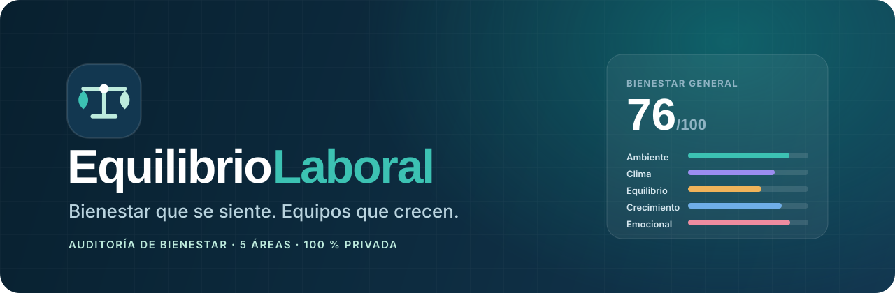

<div align="center">



<br />

**Auditoría de bienestar laboral, confidencial y en cinco áreas.**
Convierte lo que las personas sienten en un diagnóstico claro y en acciones concretas.

<br />

[](https://github.com/mhmp1960/EquilibrioLaboral)
[](https://nextjs.org/)
[](https://www.typescriptlang.org/)
[](#privacidad)

[Comenzar](#comenzar) · [La auditoría](#la-auditoría) · [Resultados](#resultados) · [Sistema de diseño](#sistema-de-diseño) · [Privacidad](#privacidad)

</div>

---

## Resumen

EquilibrioLaboral es una aplicación web para reflexionar sobre el bienestar en el trabajo. Mediante afirmaciones breves y una escala de cinco puntos, identifica fortalezas y oportunidades de mejora en un equipo, y las traduce en recomendaciones priorizadas.

No etiqueta ni diagnostica: ofrece una mirada clara para iniciar conversaciones y acordar próximos pasos.

| | |
| --- | --- |
| **5** áreas de bienestar | **23** afirmaciones |
| **< 5 min** para completarla | **0** datos enviados a servidores |

## La auditoría

| Área | Qué observa |
| --- | --- |
| **Ambiente físico y seguridad** | Iluminación, limpieza, ergonomía, herramientas y medidas de seguridad. |
| **Clima laboral y relaciones** | Respeto, comunicación, compañerismo, trato justo y resolución de conflictos. |
| **Equilibrio vida-trabajo** | Carga laboral, horarios, flexibilidad, descansos y tiempo personal. |
| **Crecimiento y reconocimiento** | Aprendizaje, reconocimiento, feedback y desarrollo profesional. |
| **Salud emocional y apoyo** | Manejo del estrés, apoyo, prevención del acoso y sentido de pertenencia. |

Cada afirmación se responde de **1 (muy en desacuerdo)** a **5 (muy de acuerdo)**. Al final hay un espacio opcional para comentarios. El avance se guarda automáticamente y puede retomarse.

## Resultados

- **Puntaje general** con indicador circular y nivel de interpretación.
- **Fortaleza y prioridad**: el área mejor y la peor puntuada, de un vistazo.
- **Gráfico comparativo** y detalle por área.
- **Recomendaciones** para las áreas con menor puntaje.
- Acciones para **imprimir o guardar como PDF**, **compartir un resumen** o **iniciar otra auditoría**.

### Cómo se calcula

1. Las respuestas de cada área se promedian y se convierten a una escala de 0 a 100 (`promedio × 20`).
2. La puntuación general es el promedio de las áreas con respuestas.
3. Las recomendaciones priorizan las áreas con menor puntuación.

| Puntaje | Nivel |
| ---: | --- |
| 80–100 | Óptimo |
| 60–79 | Mejorable |
| 40–59 | Atención media |
| 0–39 | Necesita acción |

## Sistema de diseño

Toda la interfaz se apoya en un único sistema de diseño definido en [`src/app/globals.css`](src/app/globals.css), organizado en secciones (tokens, base, layout, componentes, marca, cargador y páginas).

### Marca

| Activo | Archivo |
| --- | --- |
| Logo horizontal (fondos claros) | [`public/logo-equilibriolaboral.svg`](public/logo-equilibriolaboral.svg) |
| Logo horizontal (fondos oscuros) | [`public/logo-equilibriolaboral-claro.svg`](public/logo-equilibriolaboral-claro.svg) |
| Favicon vectorial | [`public/favicon.svg`](public/favicon.svg) |
| Favicon `.ico` | [`src/app/favicon.ico`](src/app/favicon.ico) |
| Banner del proyecto | [`public/banner.svg`](public/banner.svg) |
| Símbolo en la interfaz (con animación) | [`src/components/Marca.tsx`](src/components/Marca.tsx) |

**El símbolo** es una balanza nivelada cuyos platillos son hojas: equilibrio como base del bienestar. En la pantalla de carga la balanza oscila hasta encontrar su punto de equilibrio.

### Tokens

| Token | Valor | Uso |
| --- | --- | --- |
| `--navy-900` | `#0D2A3D` | Texto de marca, botones primarios, superficies oscuras |
| `--teal-600` | `#0B857B` | Acento principal, enlaces y estados activos |
| `--teal-400` | `#3CC2B3` | Acento sobre fondos oscuros |
| `--mint` | `#BDEBDD` | Detalles e iconos sobre azul marino |
| `--bg` / `--surface` | `#F5F8FA` / `#FFFFFF` | Fondo de página y tarjetas |

Cada área tiene un **tono** propio (`teal`, `violet`, `amber`, `blue`, `rose`) y cada nivel de resultado un **estado** (`optimo`, `mejorable`, `atencion`, `urgente`), aplicados con los atributos `data-tono` y las clases `estado-*`.

### Tipografía

- **Manrope** para títulos y cifras.
- **Inter** para texto e interfaz.
- Ambas se cargan con `next/font` (autoalojadas en la compilación, sin solicitudes externas en ejecución).

### Componentes y comportamiento

- Botones (`btn-primario`, `btn-secundario`, `btn-claro`), tarjetas, insignias, anillo de puntaje y barras de progreso.
- Pantalla de carga al abrir la aplicación y entre páginas, con tiempo máximo de seguridad.
- Transición suave entre páginas (`src/app/template.tsx`).
- Diseño adaptable (escritorio, tableta y teléfono) y estilos de impresión para los resultados.

### Accesibilidad

- Enlace «Saltar al contenido», foco visible y navegación completa por teclado.
- Preguntas como `fieldset` con opciones de radio nativas; el paso activo recibe el foco.
- Indicador de progreso con `role="progressbar"`.
- Respeta `prefers-reduced-motion`.

## Tecnologías

- [Next.js 14](https://nextjs.org/) (App Router), [React 18](https://react.dev/) y TypeScript
- [Tailwind CSS 3](https://tailwindcss.com/) (base y tokens) con CSS propio para el sistema de diseño
- [Recharts](https://recharts.org/) para la visualización
- [Lucide React](https://lucide.dev/) para iconos
- `localStorage` para guardar el avance en el dispositivo

## Comenzar

**Requisitos:** Node.js 18.17 o posterior y npm 9 o posterior.

```bash
git clone https://github.com/mhmp1960/EquilibrioLaboral.git
cd EquilibrioLaboral
npm install
npm run dev
```

Abre [http://localhost:3000](http://localhost:3000).

```bash
npm run build   # compilación de producción
npm start       # servir la compilación
```

### Publicar en Vercel

1. Importa el repositorio desde [Vercel](https://vercel.com/new).
2. Deja que Vercel detecte Next.js y usa `npm run build`.

No requiere variables de entorno ni servicios externos.

## Estructura del proyecto

```text
EquilibrioLaboral/
├── public/
│   ├── banner.svg                        # Banner del README
│   ├── favicon.svg                       # Símbolo para la pestaña
│   ├── logo-equilibriolaboral.svg        # Logo para fondos claros
│   └── logo-equilibriolaboral-claro.svg  # Logo para fondos oscuros
├── src/
│   ├── app/
│   │   ├── acerca/                       # Propósito, método y privacidad
│   │   ├── auditoria/                    # Formulario paso a paso
│   │   ├── resultados/                   # Resumen y visualización
│   │   ├── globals.css                   # Sistema de diseño
│   │   ├── layout.tsx                    # Layout, fuentes y metadatos
│   │   ├── manifest.ts                   # Manifiesto web
│   │   ├── template.tsx                  # Transición entre páginas
│   │   └── page.tsx                      # Inicio
│   ├── components/                       # Marca, navegación, cargador, formulario, resultados
│   └── lib/auditoria.ts                  # Áreas, preguntas, puntajes y recomendaciones
└── package.json
```

## Personalizar

- **Preguntas, áreas y recomendaciones:** [`src/lib/auditoria.ts`](src/lib/auditoria.ts). Cada pregunta pertenece a un área con `id`, `tono` y descripción.
- **Niveles de interpretación:** constante `NIVELES` en el mismo archivo.
- **Colores, espaciado y tipografía:** tokens al inicio de [`src/app/globals.css`](src/app/globals.css).

## Privacidad

Las respuestas y comentarios se guardan **solo en el almacenamiento local del navegador**; no hay cuentas ni servidores que las reciban. Al borrar los datos del sitio se elimina también la auditoría guardada.

Compartir genera un resumen de puntajes solo cuando la persona lo solicita. La herramienta es una guía para conversar y no constituye un diagnóstico clínico ni una auditoría legal.

## Colaboración

1. Crea una rama: `git switch -c mejora/nombre-del-cambio`.
2. Verifica con `npm run build` y `npm run lint`.
3. Abre una solicitud de cambio con una descripción clara.

---

<div align="center">
  <sub><strong>EquilibrioLaboral 1.0.0</strong> · Una iniciativa de Miguel Hermógenes Mogrovejo Pérez</sub>
</div>
